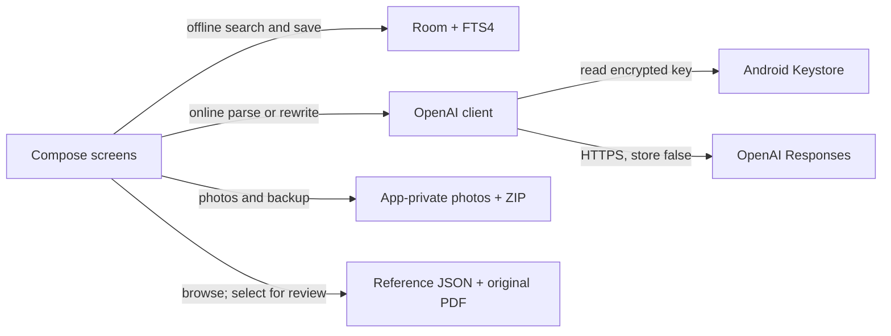
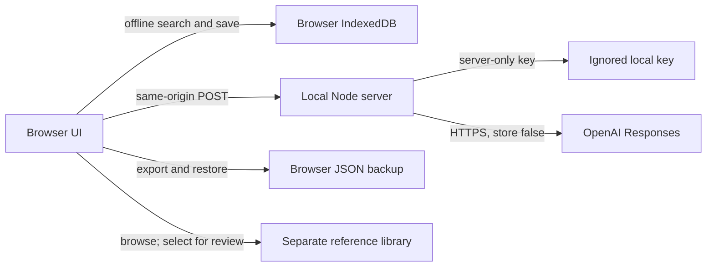

# Architecture

Generated from `project.json`. The Android catalog and browser preview have separate storage and backup formats.

## Android · the daily shop app

Local lookups and manual edits need no internet. Only explicit language-understanding requests go online.

| Component | Responsibility | Source |
| --- | --- | --- |
| Compose screens | Search, manual editing, reviewed AI entry and price cards. Cropping and discount calculations run locally. Product views, temporary discount quotes and related-product links do not save edits. | [source](../app/src/main/java/com/shopkhata/inventory/ui/DukaanApp.kt) |
| Room + FTS4 | Local items, aliases, sizes, prices in paise, history and search misses. Schema 3 adds ordered extra-product and shelf-photo lists while preserving the cover field; migrations 1→2→3 are additive. | [source](../app/src/main/java/com/shopkhata/inventory/data/CatalogRepository.kt) |
| OpenAI client | Responses API with strict JSON schemas; results go to review before saving. Explicit image parsing and category suggestions return to editable review. Explicit multi-image requests accept up to six cropped pictures, 2 MB each and 8 MB combined. Shelf albums are not sent with category suggestions. | [source](../app/src/main/java/com/shopkhata/inventory/ai/OpenAiClient.kt) |
| Android Keystore | Encrypts the phone’s API key; no key is bundled in the APK. | [source](../app/src/main/java/com/shopkhata/inventory/security/KeyStore.kt) |
| App-private photos + ZIP | Private JPEG product and shelf albums, with an explicit product cover. Version 3 ZIP backups validate both albums and restore versions 1–3. Credentials remain excluded. | [source](../app/src/main/java/com/shopkhata/inventory/backup/BackupManager.kt) |
| OpenAI Responses | Receives explicitly submitted text/images for parsing or categorization; query rewriting also receives category names. | External service |
| Reference JSON + original PDF | Immutable Prince source library with unconfirmed stock, source rates/dates and page provenance. Selection opens editable review with blank shop price/unit; only confirmed variants enter Room with unique source links. A separate source-hash-bound image manifest supplies matched table pictures; owner photos take priority. A normalized search index is built and filtered on Dispatchers.Default, separately from the input state. | [source](../app/src/main/java/com/shopkhata/inventory/data/ReferenceStore.kt) |

## Web · the localhost preview

A separate preview on this computer. Browser data is not synchronized with Android.

| Component | Responsibility | Source |
| --- | --- | --- |
| Browser UI | Dependency-free HTML/CSS/JS with editable demo items and real workflows. Cropping and discount calculations run locally. Reference typing keeps a stable input and updates a debounced indexed-results region; product views and quote discounts remain read-only. | [source](../web/public/app.js) |
| Browser IndexedDB | Separate browser catalog and history; clearly labeled sample items. | [source](../web/public/app.js) |
| Local Node server | Binds to 127.0.0.1. Sends AI requests while keeping the development key server-side. Explicit image parsing and category suggestions return to editable review. Explicit multi-image requests accept up to six cropped pictures, 2 MB each and 8 MB combined. Shelf albums are not sent with category suggestions. | [source](../web/server.mjs) |
| Ignored local key | Loaded from the process environment or .env.local; never served to browser JavaScript. | [source](../web/server.mjs) |
| Browser JSON backup | Web-preview-only export and restore; not the Android ZIP format. | [source](../web/public/app.js) |
| OpenAI Responses | Receives explicitly submitted text/images for parsing or categorization; query rewriting also receives category names. | External service |
| Separate reference library | Reads shared source JSON and local PDF/page images through fixed allowlisted routes. Selected variants require blank-price/unit review; only confirmed shop variants enter IndexedDB. A separate source-hash-bound image manifest supplies matched table pictures; owner photos take priority. | [source](../web/public/reference.js) |

## Boundaries worth keeping

- Prices belong to size/unit variants and are integer paise. GST is an explicit label, not inferred tax.
- AI parsing never writes catalog data; the user edits and confirms the review first.
- Android and web catalogs are independent. Their backups are not interchangeable.
- Schemas and listing instructions are shared from app/src/main/assets/.
- Project history is repository documentation; it does not contain API keys, private customer data or the shop catalog.
- The /project cockpit reads allowlisted project documentation. It has no catalog-writing or file-editing API.
- Images are cropped locally and sent to AI only for an explicit Review items or Suggest category request. Missing or unreadable prices must be reviewed and entered before saving.
- Discount percentages are a one-time calculator, not a persistent pricing rule: only the rounded net selling price is saved. Reopening an editor starts from that price without reapplying the discount.
- A manufacturer pricelist never proves shop stock or selling prices. Reference variants start unconfirmed and hidden from shop search. Only explicit owner confirmation creates carried shop variants; quantities remain unknown. See ADR-007.
- Display languages never rewrite catalog facts. Shared local translations and aliases preserve source IDs, technical specifications and canonical units. Original source text and custom item names remain available. See ADR-008.

## Decisions

- [ADR-001: Keep the shop catalog local on Android](decisions/ADR-001.md)
- [ADR-002: Use OpenAI only behind explicit review and key boundaries](decisions/ADR-002.md)
- [ADR-003: Keep the web build as a separate local preview](decisions/ADR-003.md)
- [ADR-004: Share one workflow and keep project memory in the repository](decisions/ADR-004.md)
- [ADR-005: Route image entry and AI categories through editable review](decisions/ADR-005.md)
- [ADR-006: Use discounts as a one-time selling-price calculator](decisions/ADR-006.md)
- [ADR-007: Keep manufacturer references separate from carried shop variants](decisions/ADR-007.md)
- [ADR-008: Display languages and source pictures without changing catalog facts](decisions/ADR-008.md)
- [ADR-009: Separate price viewing from saved price changes](decisions/ADR-009.md)
- [ADR-010: Keep product albums shelf photos and AI input batches separate](decisions/ADR-010.md)
